<a id="top"></a>

<p align="center">
  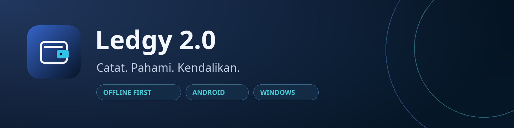
</p>

<h1 align="center">Ledgy</h1>

<p align="center">
  Pencatatan keuangan pribadi dengan antarmuka glass, input cepat, dan sinkronisasi opsional.<br>
  <strong>Mulai secara lokal. Tinjau setiap transaksi. Pahami arus kasmu.</strong>
</p>

<p align="center">
  <a href="#galeri">Lihat tampilan</a> ·
  <a href="#mulai">Jalankan aplikasi</a> ·
  <a href="#input-cepat">Coba input cepat</a> ·
  <a href="#dokumentasi">Panduan lengkap</a>
</p>

<p align="center">
  <strong>2.0.0+5</strong> · Flutter <strong>3.47.5</strong> · Dart <strong>3.13.4</strong><br>
  Android & Windows · target desktop Linux tersedia di source
</p>

---

<details>
<summary><strong>Jelajahi dokumentasi</strong> — klik untuk membuka daftar isi</summary>

- [Fitur utama](#fitur)
- [Galeri aplikasi](#galeri)
- [Mulai dari source](#mulai)
- [Input cepat dan pemindaian struk](#input-cepat)
- [Cara kerja dan arsitektur](#arsitektur)
- [Cloud dan migrasi dari versi lama](#cloud)
- [Build dan instalasi](#build)
- [Keamanan dan privasi](#keamanan)
- [Pengujian dan CI](#pengujian)
- [Pertanyaan umum](#faq)
- [Dokumentasi lanjutan dan kontribusi](#dokumentasi)

</details>

<a id="fitur"></a>

## Fitur utama

| Fitur | Yang bisa dilakukan |
| --- | --- |
| **Dashboard** | Saldo seluruh aset, pemasukan/pengeluaran, rasio tabungan, arus kas, dan transaksi terakhir. |
| **Transaksi** | Pemasukan, pengeluaran, transfer; kategori dan subkategori; tanggal/jam; catatan multibaris. |
| **Input cepat** | Ketik kalimat berbahasa Indonesia, lalu periksa dan lengkapi draf sebelum menyimpan. |
| **Kategori otomatis** | Misalnya `minum kopi` → **Makan & Minum • Cafe / Warkop**. Koreksi pengguna dapat dipelajari secara lokal. |
| **Suara** | Input `id_ID` melalui layanan ucapan perangkat, dengan izin mikrofon dan pemeriksaan bahasa. |
| **Struk Android** | Kamera/galeri → OCR Latin di perangkat → item, tanggal, toko, dan total untuk ditinjau. |
| **Anggaran & jadwal** | Batas pengeluaran bulanan, progres kategori, dan transaksi berulang harian/mingguan/bulanan. |
| **Aset & target** | Kelola akun/aset dan saldo awal; buat target tabungan di Dashboard. |
| **Laporan** | Unduh transaksi terfilter sebagai Excel/PDF; ekspor/impor CSV dengan pratinjau. |
| **Sinkronisasi** | Antrean perubahan lokal, retry ketika online, dan sinkron manual melalui akun Supabase. |
| **Kunci aplikasi** | Password 8–128 karakter dan biometrik ketika perangkat mendukung. |

Grafik arus kas menyediakan **Keseluruhan, Mingguan, Bulanan, dan Tahunan**. Periode tanpa transaksi menjadi celah; satu titik data tidak dibuatkan garis ke nol. Transfer tidak menambah total pemasukan/pengeluaran.

<a id="galeri"></a>

## Galeri aplikasi

Klik gambar untuk membukanya dalam ukuran penuh. Seluruh tampilan memakai **data demo dari pengujian UI**, bukan database keuangan pengguna. Susunan menyesuaikan ukuran layar dan platform.

### Dashboard desktop

[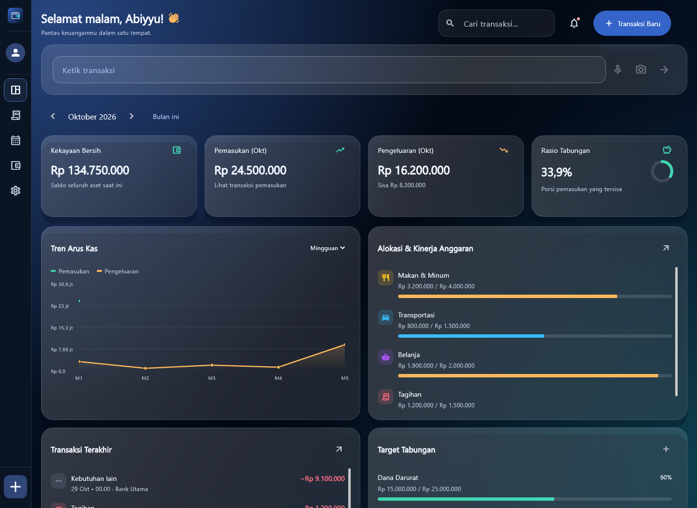](docs/media/dashboard-desktop.png)

### Tampilan mobile dan formulir

<table>
  <tr>
    <th>Dashboard mobile</th>
    <th>Transaksi manual</th>
    <th>Konfirmasi input cepat</th>
  </tr>
  <tr>
    <td align="center" valign="top"><a href="docs/media/dashboard-mobile.png">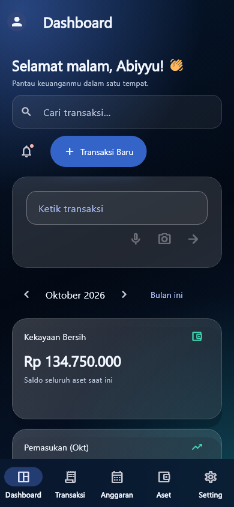</a></td>
    <td align="center" valign="top"><a href="docs/media/transaction-form.png">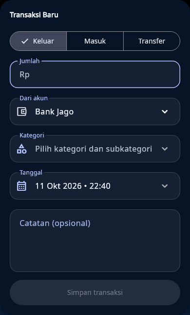</a></td>
    <td align="center" valign="top"><a href="docs/media/quick-input-confirmation.png">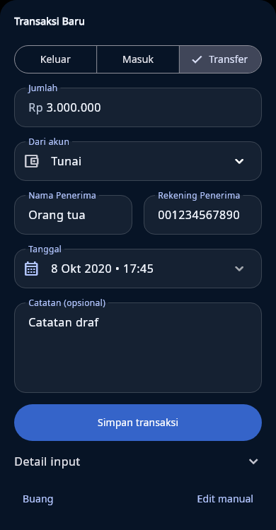</a></td>
  </tr>
</table>

<details>
<summary><strong>Lihat filter transaksi</strong></summary>

Pilih tipe, kategori/subkategori, dan akun. **Terapkan** mengubah daftar; menutup dialog tanpa menerapkan mempertahankan filter sebelumnya.

[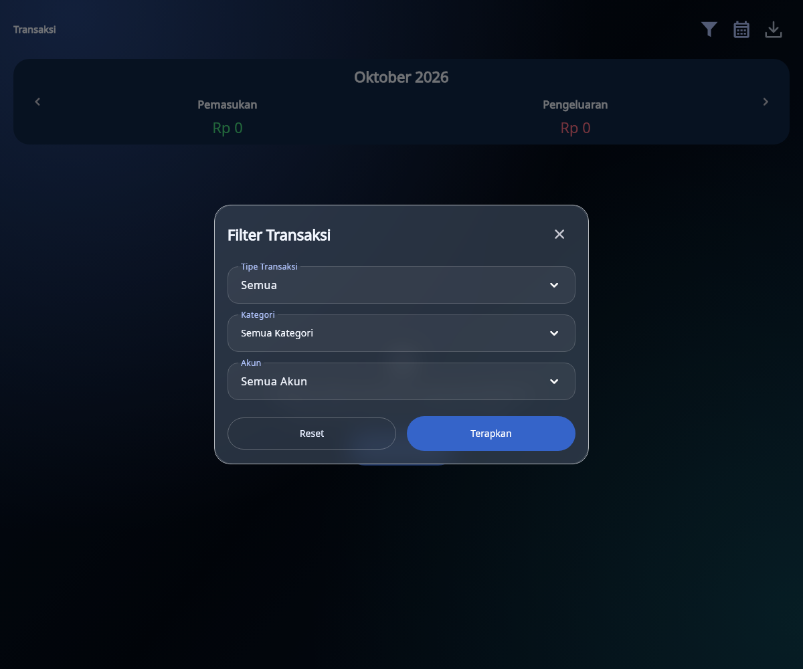](docs/media/transaction-filter.png)

</details>

<details>
<summary><strong>Lihat pengaturan dan keamanan</strong></summary>

Status sinkron, pengaturan akun, password, dan dukungan biometrik berada dalam baris pengaturan yang ringkas. Tombol biometrik tidak dapat diaktifkan ketika pemeriksaan perangkat tidak menemukan dukungan.

[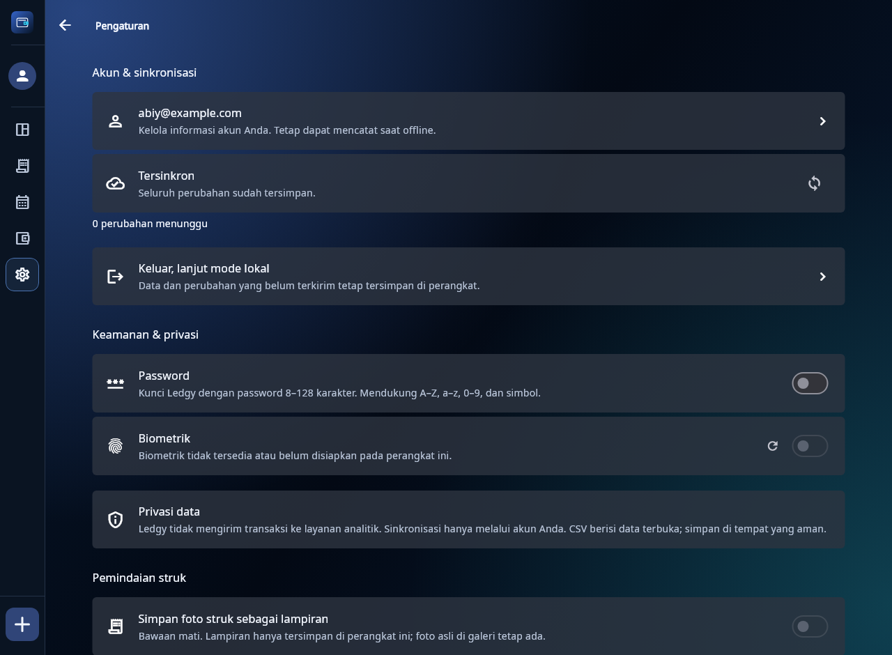](docs/media/settings-security.png)

</details>

<details>
<summary><strong>Lihat navigasi anggaran dan transaksi berulang</strong></summary>

Menu **Anggaran** memisahkan anggaran bulanan dan jadwal berulang. Jadwal diproses saat aplikasi dibuka atau aktif kembali; pekerjaan latar belakang Android mengikuti kebijakan sistem.

[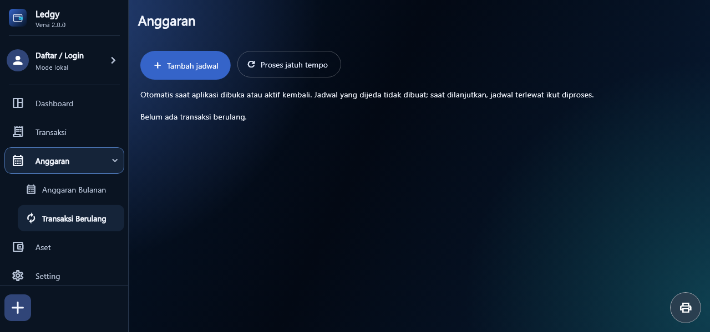](docs/media/budget-recurring.png)

</details>

[Kembali ke atas ↑](#top)

<a id="mulai"></a>

## Mulai dari source

Gunakan versi SDK yang dipin dalam [CI](.github/workflows/ci.yml): **Flutter 3.47.5 / Dart 3.13.4**. Semua perintah dijalankan dari root proyek yang memiliki `pubspec.yaml`; clone repositori ini menghasilkan folder `Ledgy`.

```bash
git clone https://github.com/abiyyufarhan/Ledgy.git
cd Ledgy
flutter doctor -v
flutter pub get --enforce-lockfile
```

Repositori private memerlukan akses GitHub. Jika source sudah ada di komputer, langsung buka folder proyek tersebut.

<details open>
<summary><strong>Windows — jalankan mode lokal</strong></summary>

Siapkan Visual Studio dengan workload **Desktop development with C++**, Windows SDK, dan CMake. Gunakan lokasi Flutter SDK tanpa spasi.

```powershell
flutter run -d windows
```

Mode lokal dapat dipakai tanpa akun atau konfigurasi cloud. Tutorial khusus Ledgy 2.0: [Menjalankan aplikasi](docs/MENJALANKAN_2_0.md).

</details>

<details>
<summary><strong>Android — jalankan melalui kabel USB</strong></summary>

Siapkan Android SDK/JDK. Aktifkan **Developer options → USB debugging**, sambungkan ponsel, lalu setujui permintaan debugging pada ponsel.

```powershell
flutter doctor --android-licenses
flutter devices
flutter run -d ID_PERANGKAT
```

Ganti `ID_PERANGKAT` dengan ID dari `flutter devices`. Perintah ini memasang build debug; proses signing rilis dijelaskan di [Build dan instalasi](#build).

</details>

<details>
<summary><strong>Linux — jalankan pada mesin Linux</strong></summary>

Contoh dependency desktop Ubuntu 24.04:

```bash
sudo apt-get update
sudo apt-get install -y clang cmake ninja-build pkg-config libgtk-3-dev liblzma-dev
flutter pub get --enforce-lockfile
flutter run -d linux
```

Build Linux dilakukan pada Linux. Pengujian perangkat nyata dan job CI tetap perlu diperiksa; keberadaan target source bukan bukti bahwa semua perangkat sudah diuji.

</details>

<a id="input-cepat"></a>

## Input cepat dan pemindaian struk

Di **Dashboard**, ketik pada kolom **Ketik transaksi**. Tekan **Enter** atau tombol panah untuk meninjau draf. Di desktop, **Ctrl+K** memfokuskan kolom tersebut.

| Contoh kalimat | Hasil yang diharapkan |
| --- | --- |
| `minum kopi 35rb pakai Tunai` | Pengeluaran Rp35.000; kategori **Cafe / Warkop**; akun Tunai. |
| `gaji delapan juta masuk ke b c a` | Pemasukan Rp8.000.000; kategori Gaji; akun BCA. |
| `bensin lima puluh ribu` | Pengeluaran Rp50.000; kategori transportasi; akun bawaan diberi peringatan. |
| `kopi 20rb via GoPay; bensin 50rb via Tunai` | Dua draf, masing-masing diperiksa dan disimpan satu per satu. |

Contoh mengasumsikan akun dan kategori yang cocok tersedia. Memori koreksi pribadi diprioritaskan, sehingga hasil kategori dapat mengikuti pilihan pengguna sebelumnya.

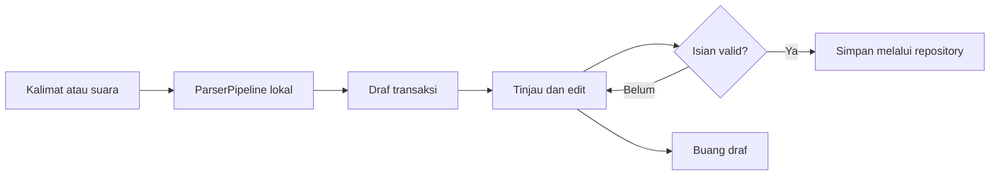

Jumlah, akun, kategori, tanggal, dan catatan dapat diperbaiki. **Simpan** nonaktif selama validasi belum selesai. **Detail input** memuat teks asli, confidence, warning, dan teks OCR untuk struk. Transfer eksternal membutuhkan nama serta rekening penerima; transfer antar-akun sendiri tetap memakai akun tujuan.

<details>
<summary><strong>Putar ilustrasi alur input cepat</strong></summary>

Animasi berikut berasal dari trailer Ledgy dan menggambarkan kalimat yang menjadi formulir konfirmasi. Ini ilustrasi dengan data demo, bukan rekaman penggunaan langsung.

<p align="center">
  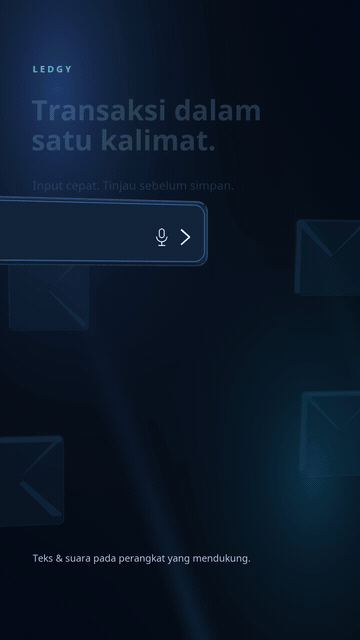
</p>

</details>

<details>
<summary><strong>Struk Android: kamera → OCR → konfirmasi</strong></summary>

1. Tekan kamera pada input cepat, lalu pilih **Kamera** atau **Galeri**.
2. Letakkan struk rata dan terang; periksa pratinjau, lalu tekan **Baca struk**.
3. Periksa total, tanggal, akun, kategori, dan daftar item.
4. Buka **Detail input → Lihat teks OCR** jika ada pembacaan yang perlu diperiksa.
5. Lengkapi isian dan simpan.

OCR Latin memakai **ML Kit di perangkat**. Foto tidak dikirim ke server oleh alur pemindaian. Foto sementara dibersihkan setelah selesai; **Simpan foto struk sebagai lampiran** bawaan mati, dan lampiran yang diaktifkan hanya disimpan lokal.

[Panduan pemindaian dan fixture OCR](docs/QUICK_INPUT_STEP5.md).

</details>

### Dukungan menurut platform

| Kemampuan | Android | Windows | Linux |
| --- | --- | --- | --- |
| Transaksi lokal dan parser teks | Tersedia | Tersedia | Target source tersedia |
| Suara bahasa Indonesia | Membutuhkan izin dan locale `id_ID` | Layanan saat ini belum menyediakan `id_ID`; gunakan ketik | Mikrofon disembunyikan |
| Pemindaian struk | Kamera/galeri + OCR | Tidak tersedia | Tidak tersedia |
| Password aplikasi | Tersedia | Tersedia | Tersedia pada implementasi lokal |
| Biometrik | Jika sensor dan biometrik sudah disiapkan | Pemeriksaan sensor dan Windows Hello | Tidak didukung |

Layanan suara meminta mode **on-device** jika perangkat mendukung; penggunaan jaringan oleh recognizer bergantung pada layanan sistem. Ledgy tidak menyimpan file audio atau transkrip sebagai log suara. Catatan transaksi yang disimpan tetap dapat berisi teks hasil input.

[Kembali ke atas ↑](#top)

<a id="arsitektur"></a>

## Cara kerja dan arsitektur

Ledgy menggunakan **Flutter + Riverpod** untuk antarmuka dan state, **GoRouter** untuk navigasi, serta **Drift/SQLite** untuk ledger lokal. Nominal disimpan sebagai **integer rupiah** dan waktu transaksi sebagai **UTC**, lalu ditampilkan mengikuti zona waktu perangkat.

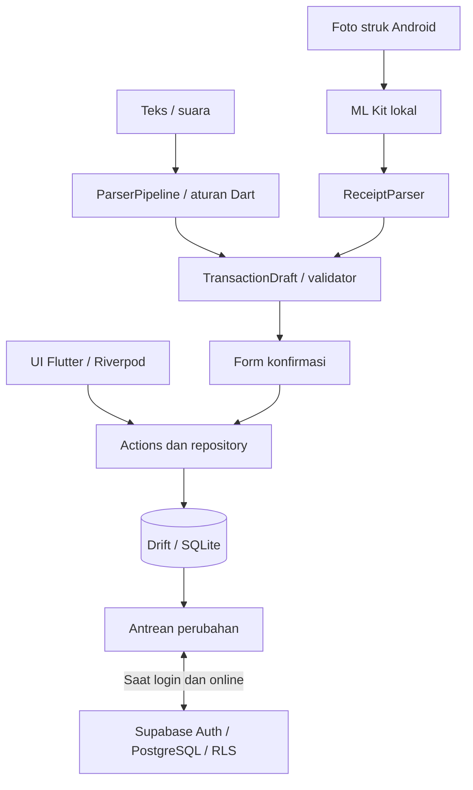

```text
lib/
├── app/                       # bootstrap aplikasi dan router
├── core/                      # tema, glass widgets, database, provider, privasi
└── features/
    ├── accounts/              # akun/aset
    ├── auth/                  # login dan profil
    ├── dashboard/             # ringkasan, grafik, target tabungan
    ├── categories/            # kategori dan subkategori
    ├── transactions/          # ledger, filter, formulir
    ├── local/                 # anggaran, notifikasi, otomasi lokal
    ├── recurring/             # jadwal transaksi berulang
    ├── quick_input/           # draf, parser, suara, struk, lab
    ├── reports/               # laporan Excel/PDF
    ├── transfer/              # ekspor/impor CSV
    ├── security/              # password dan pemeriksaan biometrik
    └── sync/                  # antrean lokal dan sinkron Supabase
```

<details>
<summary><strong>Titik masuk penting untuk pengembang</strong></summary>

| Area | Source |
| --- | --- |
| Database dan migrasi lokal | [app_database.dart](lib/core/database/app_database.dart) |
| Model draf | [transaction_draft.dart](lib/features/quick_input/domain/transaction_draft.dart) |
| Validator | [draft_validator.dart](lib/features/quick_input/domain/draft_validator.dart) |
| Pipeline parser | [parser_pipeline.dart](lib/features/quick_input/domain/parser/parser_pipeline.dart) |
| Pemilih kategori input cepat | [quick_input_categories.dart](lib/features/quick_input/data/quick_input_categories.dart) |
| Form konfirmasi | [draft_confirmation_sheet.dart](lib/features/quick_input/presentation/draft_confirmation_sheet.dart) |
| Parser struk | [receipt_parser.dart](lib/features/quick_input/domain/receipt/receipt_parser.dart) |
| Sinkronisasi | [sync_service.dart](lib/features/sync/domain/sync_service.dart) |
| Konfigurasi klien cloud | [cloud_connection.dart](lib/features/auth/data/cloud_connection.dart) |

`ParserPipeline` menyediakan titik sambung fallback, tetapi `aiFallbackEnabled` bawaan **false** dan tidak ada implementasi LLM/jaringan dalam pipeline aktif. Semua draf disimpan melalui jalur repository transaksi yang sama dengan input manual.

</details>

<a id="cloud"></a>

## Cloud dan migrasi dari versi lama

Cloud bersifat opsional. Tanpa konfigurasi, ledger lokal tetap berjalan dan login cloud dinonaktifkan. Konfigurasi dibaca **saat build**; perubahan konfigurasi memerlukan run/build ulang.

<details>
<summary><strong>Aktifkan login dan sinkronisasi</strong></summary>

1. Siapkan proyek Supabase dan aktifkan Auth Email/password; atur konfirmasi email/SMTP sesuai penggunaan.
2. Untuk backend baru, terapkan migrasi dalam urutan berikut. Pada backend yang sudah digunakan, periksa riwayat dan terapkan hanya yang belum ada:

| Urutan | Migrasi | Fungsi |
| --- | --- | --- |
| 1 | [create_ledgy_backend.sql](supabase/migrations/20261001000000_create_ledgy_backend.sql) | Tabel ledger, RLS, dan timestamp server. |
| 2 | [sync_window.sql](supabase/migrations/20261002000000_sync_window.sql) | RPC sinkronisasi. |
| 3 | [transfer_recipients.sql](supabase/migrations/20261007000000_transfer_recipients.sql) | Nama dan rekening penerima transfer. |
| 4 | [account_profile.sql](supabase/migrations/20261007010000_account_profile.sql) | Penghapusan akun milik pengguna yang terautentikasi. |

3. Tambahkan redirect Android **`com.ledgy.ledgy2://auth/callback`** di Supabase Auth. Untuk konfirmasi email rilis, gunakan Site URL yang dapat diakses pengguna.
4. Buat file konfigurasi lokal jika belum ada:

```powershell
Copy-Item supabase/client-config.example.json supabase/client-config.local.json
```

Isi Project URL dan **public anon/publishable key**. Field `SUPABASE_ANON_KEY` menerima kedua jenis key publik tersebut. Jangan menyalin ulang contoh di atas file konfigurasi yang sudah terisi.

```powershell
flutter run -d windows --dart-define-from-file=supabase/client-config.local.json
```

File lokal dikecualikan Git. **Jangan memakai `service_role`, secret key backend, token CLI, atau password database di aplikasi.** Key publik berada di binary; pemisahan data pengguna bergantung pada Auth dan RLS.

[Backend/Auth](supabase/README.md) · [Sinkronisasi](supabase/SYNC.md)

</details>

<details>
<summary><strong>Memakai Ledgy 2.0 bersama akun Ledgy 1.0</strong></summary>

Ledgy 2.0 memakai identitas Android **`com.ledgy.ledgy2`**, executable desktop **`ledgy_2_0`**, database lokal **`ledgy_2_0`**, dan namespace sesi autentikasi terpisah. Source, aplikasi, serta database lokal versi lama dapat tetap terpisah.

**Backend dan akun cloud yang sama tetap berbagi data:** perubahan dan penghapusan yang disinkronkan dapat terlihat pada kedua versi. Pemisahan instalasi lokal tidak membuat salinan backend.

[Panduan migrasi konfigurasi dan akun lama](docs/MIGRASI_KONFIGURASI_1_0.md).

</details>

<a id="build"></a>

## Build dan instalasi

<details>
<summary><strong>Windows — EXE dan installer</strong></summary>

Tutup Ledgy sebelum build agar linker tidak mengunci executable.

```powershell
flutter build windows --release --no-tree-shake-icons --dart-define-from-file=supabase/client-config.local.json
node tool/verify_windows_icons.mjs
./tool/package_installer.ps1
```

Untuk build lokal tanpa cloud, hapus argumen `--dart-define-from-file`. Bundle berada di `build/windows/x64/runner/Release/`; executable adalah **`ledgy_2_0.exe`**. Distribusi portable membutuhkan seluruh bundle, termasuk DLL dan folder `data`, bukan EXE saja.

Installer dihasilkan ke `build/releases/`. Skrip packaging memerlukan Inno Setup dan runtime yang sesuai; lihat [panduan installer Windows](docs/WINDOWS_INSTALLER.md). Installer belum ditandatangani Authenticode, sehingga Windows dapat menampilkan penerbit tidak dikenal.

```powershell
./tool/package_windows.ps1
./tool/release_checksums.ps1
```

</details>

<details>
<summary><strong>Android — APK, AAB, dan pemasangan melalui USB</strong></summary>

Build rilis membutuhkan `android/key.properties` dan keystore lokal yang valid. Contoh tersedia di [key.properties.example](android/key.properties.example). Simpan key dan password signing melalui backup privat; jangan membuat key baru untuk setiap pembaruan.

```powershell
flutter build apk --release --dart-define-from-file=supabase/client-config.local.json
flutter build appbundle --release --dart-define-from-file=supabase/client-config.local.json
adb devices
adb -s ID_PERANGKAT install -r build/app/outputs/flutter-apk/app-release.apk
```

- **APK:** `build/app/outputs/flutter-apk/app-release.apk` untuk pemasangan langsung.
- **AAB:** `build/app/outputs/bundle/release/app-release.aab` untuk distribusi Google Play, bukan instalasi langsung.
- **Debug:** `flutter build apk --debug`, lalu pasang `app-debug.apk` untuk pengembangan.

Pembaruan harus memakai application ID dan signing key yang cocok. Jika muncul `INSTALL_FAILED_UPDATE_INCOMPATIBLE`, siapkan ekspor/sinkronisasi dan rencana pemulihan sebelum uninstall; uninstall dapat menghapus data lokal. Naikkan versi/build di `pubspec.yaml` sebelum distribusi pembaruan.

Skrip `tool/build_configured.ps1 -Target android` juga tersedia untuk build dengan konfigurasi lokal yang divalidasi.

</details>

<details>
<summary><strong>Linux — bundle desktop</strong></summary>

Jalankan pada mesin Linux dengan dependency dari [Mulai dari source](#mulai):

```bash
flutter build linux --release --dart-define-from-file=supabase/client-config.local.json
./build/linux/x64/release/bundle/ledgy_2_0
```

Distribusikan seluruh folder `build/linux/x64/release/bundle/` dan pertahankan izin executable. Biometrik tidak didukung pada Linux.

</details>

<a id="keamanan"></a>

## Keamanan dan privasi

| Area | Perilaku saat ini |
| --- | --- |
| Kredensial | `.gitignore` mengecualikan konfigurasi lokal, `.env`, signing key, database, backup, dan hasil build. |
| Password | Password kunci aplikasi disimpan sebagai hash dengan salt; pengaturan mendukung 8–128 karakter. |
| Biometrik | Diperiksa sebelum aktivasi; Windows Hello dapat menawarkan PIN OS setelah pemeriksaan sensor. |
| Parser | Aturan, memori koreksi, dan diagnostik parser diproses lokal. |
| Foto struk | OCR lokal, penghapusan foto sementara, lampiran lokal hanya jika diaktifkan. |
| Sinkronisasi | Data ledger dikirim ke backend Supabase akun pengguna ketika login/sinkronisasi aktif. |
| Batas perlindungan | Kunci aplikasi **tidak mengenkripsi database**. SQLCipher dan backup terenkripsi belum diimplementasikan. |

<details>
<summary><strong>Periksa sebelum commit atau push</strong></summary>

```powershell
./tool/check_github_safety.ps1
git diff --cached --stat
```

Pemeriksaan menandai pola kredensial yang dikenal tanpa mencetak nilai rahasia. Hasil PASS tidak menjamin semua format rahasia terdeteksi; tinjau berkas baru, jangan gunakan `git add -f` untuk memasukkan konfigurasi privat.

`.gitignore` tidak menghapus berkas yang sudah dilacak. Jika rahasia pernah terunggah, cabut/ganti kredensial lalu bersihkan riwayat sesuai [panduan GitHub](https://docs.github.com/en/authentication/keeping-your-account-and-data-secure/removing-sensitive-data-from-a-repository).

[Panduan unggah GitHub](docs/GITHUB_UPLOAD.md) · [Pengaturan keamanan](docs/SETTINGS_SECURITY.md)

</details>

<details>
<summary><strong>Ekspor, backup, dan data yang hanya lokal</strong></summary>

Ekspor CSV melalui menu Print di **Anggaran**. CSV memuat transaksi, tetapi bukan backup penuh saldo awal aset, anggaran, jadwal, pengaturan, atau sesi login. Excel/PDF mengikuti periode dan filter pada halaman Transaksi.

Target tabungan, memori parser, diagnostik kegagalan, dan lampiran foto bersifat lokal. Sinkronisasi bukan backup point-in-time: penghapusan yang disinkronkan juga dapat mencapai perangkat lain.

Database 2.0 memakai nama `ledgy_2_0` melalui Drift di direktori application-support OS. Untuk salinan desktop, tutup aplikasi lebih dahulu dan simpan database beserta sidecar yang masih diperlukan sebagai satu set di media aman. Lokasi nyata mengikuti OS; database bukan berada dalam folder build. Database Android berada di sandbox aplikasi, dan belum tersedia tombol backup penuh Android.

Format CSV dan batas pemulihan dijelaskan di [implementasi CSV](lib/features/transfer/domain/ledger_csv.dart) dan [catatan keamanan](docs/PHASE7.md).

</details>

[Kembali ke atas ↑](#top)

<a id="pengujian"></a>

## Pengujian dan CI

```powershell
flutter analyze --no-pub
flutter test --no-pub
flutter test --no-pub --coverage
```

<details>
<summary><strong>Jalankan pengujian parser dan formulir</strong></summary>

```powershell
flutter test --no-pub test/domain/draft_validator_test.dart
flutter test --no-pub test/domain/parser_pipeline_test.dart
flutter test --no-pub test/domain/parser_corpus_golden_test.dart
flutter test --no-pub test/domain/receipt_parser_test.dart
flutter test --no-pub test/draft_confirmation_sheet_test.dart
dart tool/parser_benchmark.dart
```

Korpus berisi **120 kalimat sintetis** dan **8 fixture OCR sintetis**. Golden mengukur akurasi per kolom dan total struk. Target regresi nominal ≥90%, total fixture struk ≥80%, dan p95 parser <50 ms di mesin pengujian; hasil ini bukan jaminan OCR foto nyata atau performa semua ponsel.

Pada debug build, buka **Pengaturan → Input cepat → Lab parser** untuk melihat langkah aturan, confidence, warning, dan durasi. **Debug OCR struk** Android mengekspor `OcrLine` ke JSON. Lab/debug OCR tidak tampil pada build rilis.

Opsi **Catat kalimat gagal diurai** bawaan mati. Jika diaktifkan, input teks yang gagal dicatat lokal, dapat diekspor, dan dapat dihapus; suara serta teks OCR tidak masuk log kegagalan tersebut.

[Korpus kalimat](test/fixtures/PHRASES.md) · [Evaluasi parser](docs/QUICK_INPUT_STEP6.md)

</details>

<details>
<summary><strong>GitHub Actions dan build Android bertanda tangan</strong></summary>

Workflow [Ledgy CI](.github/workflows/ci.yml) berada di root repositori. Push/PR menjalankan analyze, pengujian, coverage, build Windows/Linux, dan APK debug. Lihat hasil run di [GitHub Actions](https://github.com/abiyyufarhan/Ledgy/actions); README tidak menganggap job lulus sebelum run benar-benar selesai.

Untuk build rilis Android, buat environment **`android-release`**, atur branch/reviewer sesuai kebutuhan, lalu simpan secrets:

| Secret | Isi |
| --- | --- |
| `LEDGY_KEYSTORE_BASE64` | Keystore rilis dalam base64. |
| `LEDGY_KEY_ALIAS` | Alias signing key. |
| `LEDGY_STORE_PASSWORD` | Password keystore. |
| `LEDGY_KEY_PASSWORD` | Password key. |

Repository Variables **`SUPABASE_URL`** dan **`SUPABASE_ANON_KEY`** hanya untuk konfigurasi klien publik. Jalankan **Actions → Ledgy CI → Run workflow → release_android=true**. Jangan mengunggah keystore sebagai artifact atau menulis nilainya ke source/log.

</details>

<a id="faq"></a>

## Pertanyaan umum

<details>
<summary><strong>Mengapa tombol login tidak bisa ditekan?</strong></summary>

Periksa validitas email/password dan konfigurasi cloud. Build tanpa `--dart-define-from-file=supabase/client-config.local.json` berjalan lokal dan tidak mengaktifkan login cloud. Isi konfigurasi publik yang valid, lalu run/build ulang. Konfirmasi email jika diwajibkan backend.

</details>

<details>
<summary><strong>Mengapa Simpan pada input cepat masih nonaktif?</strong></summary>

Jumlah harus lebih dari nol, akun wajib terisi, dan transaksi pemasukan/pengeluaran perlu kategori. Periksa juga tanggal dan tujuan/penerima transfer. Kolom bermasalah memiliki peringatan inline; lengkapi sebelum menyimpan.

</details>

<details>
<summary><strong>Apakah kategori dari prompt berbeda dengan transaksi manual?</strong></summary>

Pemilihnya sama: kategori induk, subkategori, pencarian, ikon berwarna, dan kategori pribadi. Parser hanya mengusulkan pilihan awal; pengguna tetap dapat menggantinya. [Panduan kategori](docs/QUICK_INPUT_CATEGORY_PICKER.md).

</details>

<details>
<summary><strong>Mengapa mikrofon, kamera, atau biometrik tidak tersedia?</strong></summary>

Suara membutuhkan dukungan layanan sistem, izin, dan locale Indonesia. Kamera/OCR struk hanya tersedia di Android. Biometrik membutuhkan hardware dan konfigurasi yang didukung; Linux belum mendukungnya. Gunakan input teks/password ketika opsi perangkat tidak tersedia.

</details>

<details>
<summary><strong>Apakah Ledgy 2.0 mengubah data Ledgy 1.0?</strong></summary>

Instalasi dan database lokal 2.0 terpisah. Jika kedua versi masuk ke akun dan backend Supabase yang sama, perubahan cloud tetap dibagikan, termasuk penghapusan yang disinkronkan. [Rincian migrasi](docs/MIGRASI_KONFIGURASI_1_0.md).

</details>

<a id="dokumentasi"></a>

## Dokumentasi lanjutan dan kontribusi

| Kebutuhan | Panduan |
| --- | --- |
| Menjalankan 2.0 dan migrasi | [Menjalankan Ledgy 2.0](docs/MENJALANKAN_2_0.md) · [Konfigurasi dari 1.0](docs/MIGRASI_KONFIGURASI_1_0.md) |
| Draf dan parser | [Langkah 1](docs/QUICK_INPUT_STEP1.md) · [Langkah 2](docs/QUICK_INPUT_STEP2.md) · [Pipeline](docs/QUICK_INPUT_STEP4.md) |
| Suara, struk, dan evaluasi | [Suara](docs/QUICK_INPUT_STEP3.md) · [OCR](docs/QUICK_INPUT_STEP5.md) · [Lab/metrik](docs/QUICK_INPUT_STEP6.md) |
| Kategori dan form | [Cafe / Warkop](docs/QUICK_INPUT_CATEGORIES.md) · [Pemilih kategori](docs/QUICK_INPUT_CATEGORY_PICKER.md) · [Form prompt](docs/QUICK_INPUT_FORM_UI.md) |
| Backend dan sinkronisasi | [Supabase](supabase/README.md) · [Sync](supabase/SYNC.md) |
| Keamanan dan distribusi | [Settings](docs/SETTINGS_SECURITY.md) · [Installer Windows](docs/WINDOWS_INSTALLER.md) · [GitHub](docs/GITHUB_UPLOAD.md) |
| Asal gambar README | [Aset dokumentasi](docs/media/README.md) |

Catatan langkah/fase merekam kondisi saat fitur dibuat; gunakan README ini dan source saat ini untuk perilaku terbaru.

Untuk perubahan kode, buat branch, gunakan akun/data uji, jalankan pengujian yang sesuai, dan sertakan screenshot bila UI berubah. Hindari data pribadi dalam fixture, issue, screenshot, dan pull request. Repository ini belum memiliki file lisensi proyek; font Noto Sans memiliki [OFL](assets/fonts/OFL.txt) tersendiri.

<p align="center"><strong>Ledgy — Catat. Pahami. Kendalikan.</strong><br><a href="#top">Kembali ke atas ↑</a></p>
